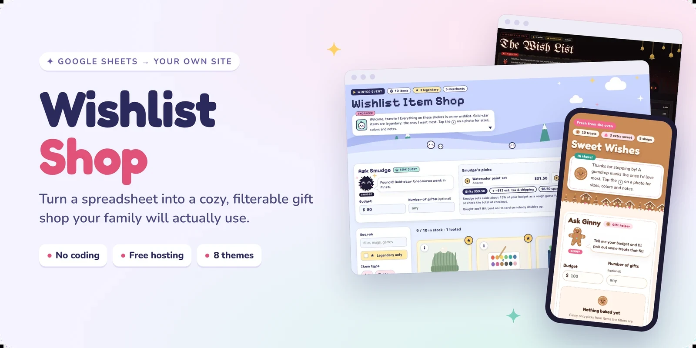
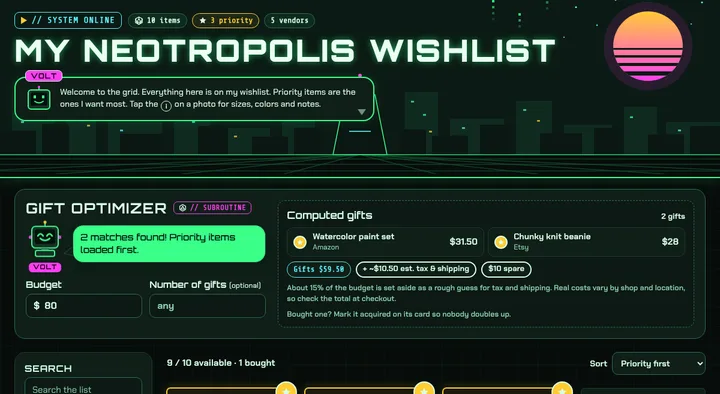

<p align="center">
  
</p>

<p align="center">
  <a href="https://nicolenadine.github.io/wishlist/"><b>See the live demo</b></a>
  &nbsp;·&nbsp;
  <a href="docs/setup.md"><b>Setup guide</b></a>
  &nbsp;·&nbsp;
  <a href="#themes"><b>Themes</b></a>
  &nbsp;·&nbsp;
  <a href="#questions"><b>Help</b></a>
</p>

<p align="center">
  
  
  
  
  <a href="LICENSE"></a>
</p>

Keep your wishlist in a Google Sheet, and this turns it into a little online shop that friends and family can actually enjoy browsing. They can filter by price or store, see what you want most, get gift ideas that fit their budget, and quietly mark what they bought so nobody doubles up. You never see the spoilers.

You update it by editing the spreadsheet. There's nothing to install and nothing to pay for.

<p align="center">
  
</p>

## What gift-givers get

- **A shop, not a spreadsheet.** Photos, prices and where to buy, with filters for price, store and category. Your favorites float to the top.
- **A gift helper.** Type in a budget and it suggests gifts that fit, holding a little back for tax and shipping.
- **No doubled-up gifts.** One tap marks something as bought. Everyone else sees it's taken; you don't.
- **Sale prices.** Optional daily price checks show when something you want goes on sale.
- **A look that fits the occasion.** Eight themes, from a pixel-art item shop to a Krampus night to a neon city of the future. Pick one from a dropdown.

## How it works

<p align="center">
  
</p>

## Set it up in about 10 minutes 
See detailed setup guide <a href="docs/setup.md"><b>HERE</b></a>

> [!NOTE]
> You'll need a free Google account and a free [GitHub account](https://github.com/signup). No coding and no downloads. The [illustrated setup guide](docs/setup.md) walks through every click.
>
> **Tip:** open the buttons below with **Ctrl-click** (**⌘-click** on a Mac) so this page stays open while you work.

**1. Copy the spreadsheet.** It comes with example items, a **Settings** tab, a **How to use** tab and a **Wishlist** menu that handles updates and gift claiming for you.

[](https://docs.google.com/spreadsheets/d/1xcYWpix2X1ZDpUfDu7IXhiKeWtpUENBPletfdRZQ8g8/copy)

**2. Publish it so your site can read it.** In your copy: **File → Share → Publish to web**, choose **Entire document** and **Comma-separated values (.csv)**, then **Publish**. Copy the link it gives you.

**3. Make your own copy of this site.**

[](https://github.com/nicolenadine/wishlist/fork)

**4. Connect the two.** In your copy on GitHub, click the name `config.js` in the file list (the name itself, not the grey text beside it), click the pencil icon, paste your sheet link between the quotes after `sheetUrl:` (keep the comma at the end of the line), and click **Commit changes**. That's the only file you ever need to edit.

**5. Turn on the website.** Go to **Settings → Pages**, set the branch to `main` and the folder to `/ (root)`, and click **Save**. In a minute or two your list is live at `https://your-username.github.io/wishlist/`.

> [!TIP]
> Before you share the link, open it once on each of your own devices with `?shield` on the end (like `…/wishlist/?shield`). That hides what's been bought in that browser, so you can browse your own list without spoilers.

Everything else (your name, your theme, the title, gift claiming) is set in the sheet's **Settings** tab. Changes show up on your site within about 5 minutes.

## Themes

Pick one from the **Theme** dropdown in your sheet's Settings tab. To try one first, add `?theme=` and the folder name to your site's address. Click a picture to preview it on the demo.

<table>
  <tr>
    <td width="33%" valign="top"><a href="https://nicolenadine.github.io/wishlist/?theme=rpg-shop"></a><br><b>RPG Item Shop</b><br><sub>Pixel-game shop. Gift-givers "loot" what they buy and Smudge the soot sprite picks gifts.</sub></td>
    <td width="33%" valign="top"><a href="https://nicolenadine.github.io/wishlist/?theme=hearthside"></a><br><b>Hearthside</b><br><sub>Classic Christmas in evergreen and cranberry. Large, easy-to-read text.</sub></td>
    <td width="33%" valign="top"><a href="https://nicolenadine.github.io/wishlist/?theme=winter-lights"></a><br><b>Winter Lights</b><br><sub>Navy and silver with a string of lights, for any winter holiday.</sub></td>
  </tr>
  <tr>
    <td valign="top"><a href="https://nicolenadine.github.io/wishlist/?theme=shiny-bright"></a><br><b>Shiny &amp; Bright</b><br><sub>Mid-century retro: tinsel trees, glass ornaments and starbursts.</sub></td>
    <td valign="top"><a href="https://nicolenadine.github.io/wishlist/?theme=krampusnacht"></a><br><b>Krampusnacht</b><br><sub>The dark side of the holidays, with a woodcut Krampus running the gift helper.</sub></td>
    <td valign="top"><a href="https://nicolenadine.github.io/wishlist/?theme=gingerbread"></a><br><b>Gingerbread</b><br><sub>A kawaii bakery with Ginny the cookie. Works for birthdays too.</sub></td>
  </tr>
  <tr>
    <td valign="top"><a href="https://nicolenadine.github.io/wishlist/?theme=starter"></a><br><b>Starter</b><br><sub>Plain and simple. The one to copy when you make your own.</sub></td>
    <td valign="top"><a href="https://nicolenadine.github.io/wishlist/?theme=neotropolis"></a><br><b>Neotropolis</b><br><sub>A retro-future neon city at night, with Volt the robot running the gift helper.</sub></td>
    <td valign="middle" align="center"><b>Make your own</b><br><sub>Describe it to an AI and preview it in the <a href="https://nicolenadine.github.io/wishlist/theme-lab.html">Theme Lab</a>, no code needed: <a href="docs/make-a-theme-with-ai.md">Make a theme with AI</a>.<br><br>Or build one by hand with the <a href="themes/README.md">themes guide</a>, and <a href="themes/README.md#share-your-theme-with-everyone">share it</a> so everyone can use it (optional).</sub></td>
  </tr>
</table>

## Keeping it up to date

- **Add, change or remove items** right in the sheet. The [sheet guide](docs/sheet-guide.md) covers every column, photos and gift cards.
- **Change your theme, name or title** on the sheet's **Settings** tab.
- **New sheet options:** the occasional update adds an optional setting to the sheet. In your sheet, click **Wishlist → Check for updates** and say yes. ([About the Wishlist menu](docs/sheet-menu.md), or add them by hand from [Sheet changes](docs/sheet-changes.md).)
- **Check that everything's working:** add `?check` to the end of your site's address. You'll get a plain-language checklist of your sheet, settings, theme and claiming, with a fix for anything that's off.
- **Get new features and themes:** on your copy's GitHub page, click **Sync fork → Update branch**. Your settings and your sheet stay exactly as they are, so there's nothing to copy over. New themes also appear in your sheet's Theme dropdown on their own.

> [!CAUTION]
> If **Sync fork** ever says it can't update automatically, or offers to **Discard commits**, don't click Discard. It would erase your own changes: your sheet link in `config.js`, any photos you uploaded, and any themes you made. Close the box instead (nothing has changed yet) and [open an issue](https://github.com/nicolenadine/wishlist/issues/new) with a link to your copy. It's fixable.

<details>
<summary><b>Let gift-givers mark items as bought</b></summary>
<br>

In your sheet, click **Wishlist → Set up gift claiming**. It makes your claim form and connects it for you (or do it by hand in a few minutes). Every item gets a button for gift-givers, purchases are recorded in hidden tabs in your sheet, and items grey out once they're taken. [Turn on claiming →](docs/claiming.md)

</details>

<details>
<summary><b>Show sale prices with daily price checks</b></summary>
<br>

A free GitHub Action checks prices every morning and shows sales on the cards. It works for Steam and Nintendo out of the box, and Etsy with a free API key. [Set up price checks →](docs/price-checks.md)

</details>

## Questions

> [!TIP]
> Start with the setup check: open your site with `?check` on the end, like `https://your-username.github.io/wishlist/?check`. It spots most problems and tells you how to fix them.

<details>
<summary><b>My site says "No sheet connected yet."</b></summary>
<br>

The sheet link in `config.js` is missing or has a typo. Copy it again from **File → Share → Publish to web** and make sure it's between the quotes after `sheetUrl:`, with a comma at the very end of the line:

```js
sheetUrl: 'https://docs.google.com/spreadsheets/d/e/…/pub?output=csv',
```

A missing comma or quote is the most common slip, and your site's setup check (`?check`) will point to the exact line.

</details>

<details>
<summary><b>I changed the sheet but the site didn't update.</b></summary>
<br>

Google takes up to about 5 minutes to republish. Wait a few minutes, then refresh. If it's still old, check that **Automatically republish when changes are made** is ticked under **File → Share → Publish to web**.

</details>

<details>
<summary><b>I picked a theme in the Settings tab, but nothing changed.</b></summary>
<br>

Check that you published the **Entire document**, not just the Items tab, and that **Items** is still the first tab. Then give it about 5 minutes.

</details>

<details>
<summary><b>My sheet shows a yellow "external parties" warning, or the Theme dropdown is empty.</b></summary>
<br>

Click **Allow access** on the yellow bar. It's the Theme dropdown fetching the current list of themes, so new ones appear automatically. Nothing from your sheet is sent anywhere ([more about this warning](docs/about-the-warnings.md)). You can also type a theme's name into the cell instead.

</details>

<details>
<summary><b>The Wishlist menu says "Google hasn't verified this app."</b></summary>
<br>

That's expected the first time, and you only see it once. The script lives in your own copy of the sheet, so the "developer" Google names on that screen is you. Click **Advanced → Go to Wishlist Shop (unsafe)**, tick **Select all**, then **Continue**. The [menu guide](docs/sheet-menu.md) walks through each screen, and [About Google's warnings](docs/about-the-warnings.md) explains in plain words why it's safe and how to check for yourself.

</details>

<details>
<summary><b>An item's photo doesn't show up.</b></summary>
<br>

Some stores block their images from appearing on other sites. Try **Copy image address** on a different photo of the product, or save the photo to the `wishlist-images` folder instead. See [Adding photos](docs/sheet-guide.md#adding-photos).

</details>

<details>
<summary><b>Will I see what people bought?</b></summary>
<br>

Not unless you go looking. Purchases go to a hidden tab in your sheet, so don't unhide it. Turn on the spoiler shield on your own devices (`?shield` at the end of your link) and your site hides them too.

</details>

Still stuck? [Open an issue](https://github.com/nicolenadine/wishlist/issues) and describe what you see.

<details>
<summary><b>For developers</b></summary>
<br>

No build step and no dependencies: plain HTML, CSS and JavaScript, served by GitHub Pages.

```
config.js           sheet link plus advanced options (the only file most people edit)
app.js              loads the sheet and Settings tab, filters, cards, gift helper, claims
index.html          page structure
styles.css          shared layout; colors and fonts come from the theme
themes/             one folder per theme (CSS, JSON and SVG only), plus themes.csv (the theme list the sheet's dropdown reads)
theme-lab.html      the Theme Lab: paste a theme and preview it on sample items (frames index.html?lab)
theme-lab/          the lab's script and sample item pictures
skills/             wishlist-theme/SKILL.md, the theme-making instructions for Claude and other AIs
sheet/              the sheet's optional Wishlist menu (Apps Script) and updates.json, the list of sheet changes it applies
scripts/            daily price check, run by .github/workflows/update-prices.yml
wishlist-images/    optional photos hosted in the repo
docs/               guides and the images in this README
```

**Run it locally.** Browsers won't load the sheet from a file opened directly, so serve the folder:

```
python3 -m http.server 8000
```

Then open http://localhost:8000. Handy URL switches: `?check` shows the setup report, `?theme=name` previews a theme, `?test-claims` fakes purchases without sending anything, `?shield` / `?shield=off` turn the spoiler shield on and off, and `?lab` (only inside the Theme Lab's frame) shows sample items with a theme sent by the lab.

**Sheet changes are always additive and optional.** A change must never break an existing sheet or require copying it again: new settings fall back to a default when their row is missing, and new columns are optional. Any change that touches the sheet gets an entry in [`sheet/updates.json`](sheet/updates.json), so the sheet's **Wishlist → Check for updates** can apply it, and in [docs/sheet-changes.md](docs/sheet-changes.md) for people adding it by hand (the format is in a comment at the bottom). Updates are data, not code: each one is a list of actions that [`sheet/Wishlist.gs`](sheet/Wishlist.gs) already knows (`settingRow`, `formulaTab`, `settingDropdown`). A new kind of action means a new `SCRIPT_VERSION` in the script and a matching `menuVersion` in `updates.json`, and new Settings rows go in `SETTING_NAMES` and `SETTING_LABELS` in `app.js` so `?check` can suggest them.

**Don't change files that copies edit.** **Sync fork** stops with a conflict, and offers to discard people's own work, whenever this repo and a copy both change the same lines. Copies edit `config.js` (at least the sheet link), add photos to `wishlist-images/`, and add their own theme folders. So:
- Never change `config.js` here, not even a comment. New options go in the sheet's Settings tab, with their defaults in `DEFAULTS` in `app.js`.
- Only `README.md` lives in `wishlist-images/`; don't add sample photos there.
- `themes/themes.csv` lists shared themes only. Copies never need to edit it (the site finds a personal theme's folder from its name), so adding a line here for a new shared theme is safe.

**Settings.** Anything in the sheet's Settings tab can also be set in `config.js`; the sheet wins when both are filled in, and `config.js` is the fallback if the tab is missing. When you change `app.js` or `styles.css`, bump the `?v=` number in `index.html` so browsers fetch the new version. `config.js` is always fetched fresh, so people's edits show up as soon as GitHub publishes them.

</details>

## License

© 2026 Nicole Nadine. Released under the [GNU General Public License v3](LICENSE).

You're free to use, copy, change and share this, including for commercial projects. If you share a changed version, it has to stay open source under the same license, with the source available. Your own copy for your wishlist is fine as is: forks on GitHub are already public.

