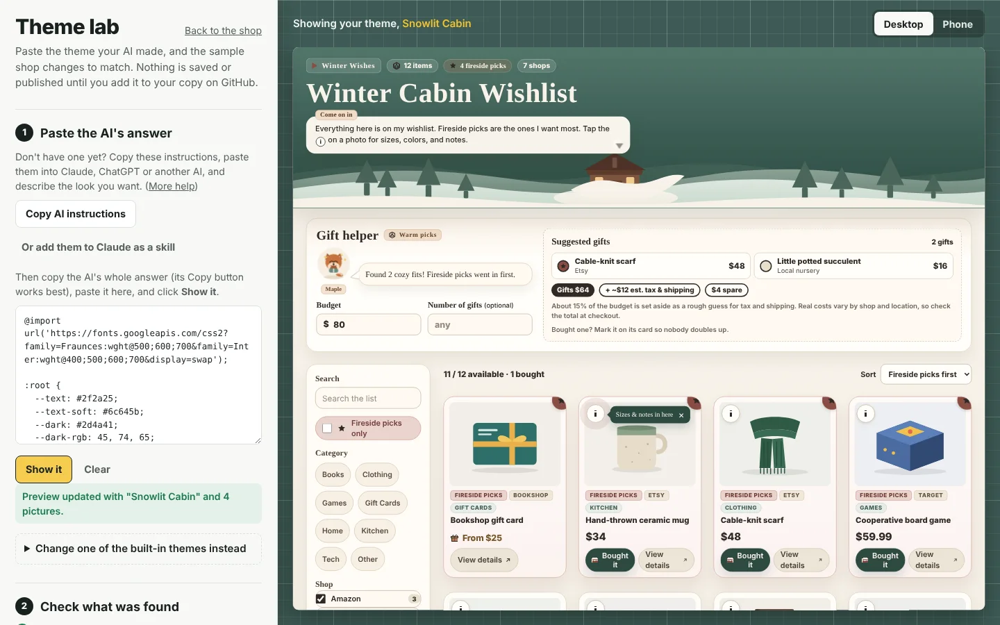
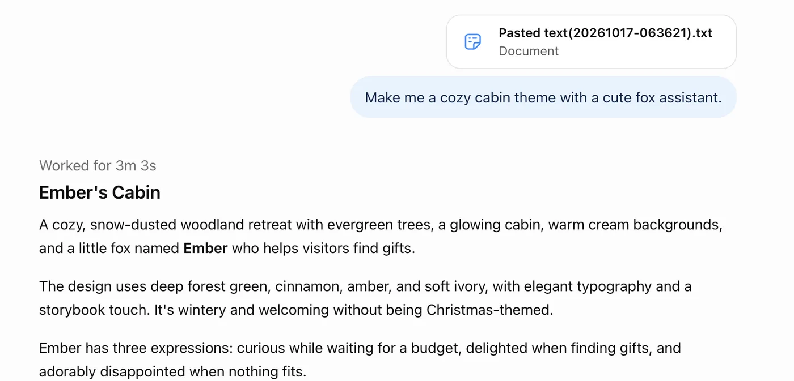
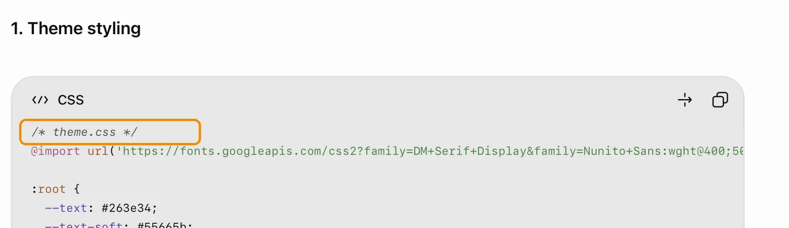
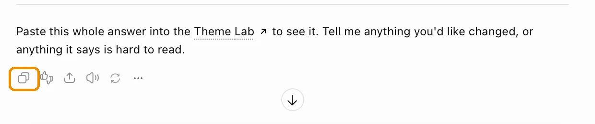
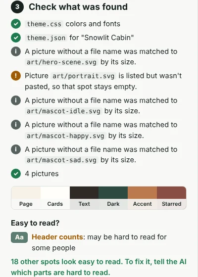
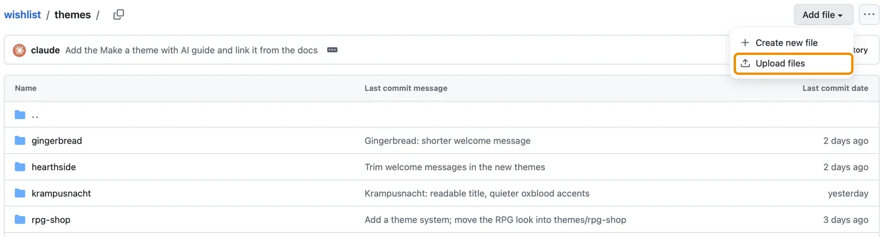
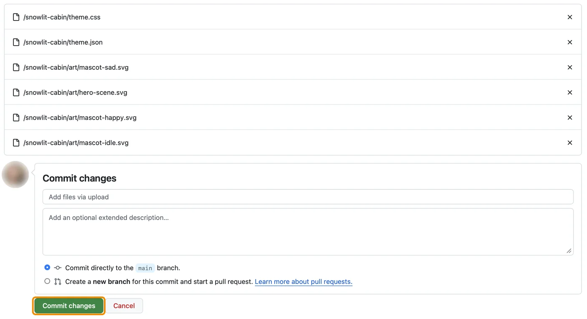
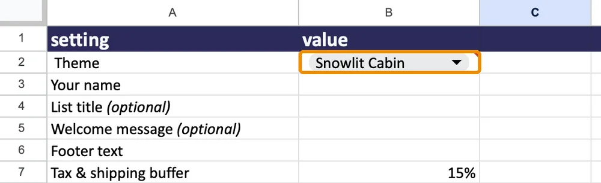
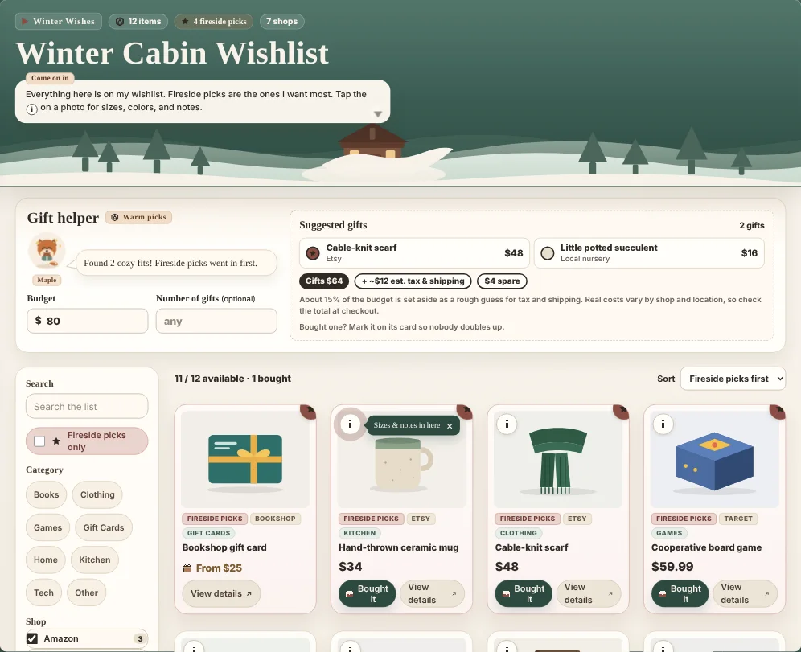

# Make a theme with AI

You don't need to know any code to make your own theme. Describe the look you want to an AI like Claude or ChatGPT, paste its answer into the **Theme Lab**, and watch a sample shop change to match. When it looks right, download it and add it to your wishlist.

## 1. Open the Theme Lab

Open the lab on the demo site: **https://nicolenadine.github.io/wishlist/theme-lab.html**

Your own wishlist has one too, at your site's address followed by `theme-lab.html`. If yours isn't there yet, update your copy (**Sync fork → Update branch** on GitHub). Both work the same, and nothing you do in the lab changes anyone's site.

## 2. Give your AI the instructions

In the lab, click **Copy AI instructions**. Start a **new** chat in Claude, ChatGPT, Gemini or another AI, paste them in, and then say what you'd like. A single sentence is plenty:

The AI may ask a couple of questions first. Answer them, or say "you pick." If your visitors include older relatives, say so, and it will use larger, easier text.

You'll get a few code boxes back, one per file. Each one starts with a line naming the file, like `/* theme.css */`. That's how the lab knows what's what, so there's nothing for you to do with it.

**Using Claude?** You can add the instructions as a skill, so you don't have to paste them each time. In the lab, click **Or add them to Claude as a skill** to download `wishlist-theme-skill.zip`, then upload it in Claude under **Settings → Capabilities → Skills**. After that, just ask Claude to make you a wishlist theme. Skills need a paid Claude plan and code execution turned on; [Claude's guide to skills](https://support.claude.com/en/articles/12512180-using-skills-in-claude) has the details.

## 3. Paste the answer into the lab

Scroll to the end of the AI's answer and click the **Copy** button under the whole reply. Don't use the copy buttons on each code box: those copy just one file.

Paste it into the lab's box and click **Show it**. The sample shop changes to your theme, and a message under the button says what the lab found.

Then look under **Check what was found**:

- **Which files it found.** A green check means it's there. If something is missing or has a typo, the lab says what to ask the AI.
- **The theme's colors.**
- **Easy to read?** The lab checks the text all over the sample shop. If it flags something, tell the AI exactly that.

For the theme above, you'd say: *"The lab says portrait.svg is missing and the header counts may be hard to read. Please fix them and send all the files again."*

Try the **Phone** button at the top too. Most people will open your list on a phone.

## 4. Ask for changes

Keep chatting with the AI until you love it: *"Make the header darker," "Call starred items Top Picks," "Make the fox look happier."* Each time, copy its new answer, click **Clear** in the lab, paste, and click **Show it**.

Always ask for **all the files** each time. The lab shows exactly what's pasted, so a half answer gives you half a theme.

Want someone's opinion first? Click **Copy a preview link** and send it to them. The link opens the lab with your theme in it.

## 5. Add it to your wishlist

**Download it.** In the lab, click **Download theme folder**. You get a zip file; open it to get a folder named after your theme, like `snowlit-cabin`.

**Upload the folder.** On GitHub, open **your copy** of the wishlist (not the original template) and go into the **themes** folder. Click **Add file → Upload files**.

Drag the whole folder onto the page. Every file should be listed under your theme's folder name. Leave **Commit directly to the main branch** selected and click **Commit changes**.

**Add it to the theme list.** Still in the **themes** folder, open **themes.csv**, click the pencil, add the line the lab shows you (like `Snowlit Cabin,snowlit-cabin`) at the very end, and click **Commit changes**.

**Switch to it.** In your sheet's **Settings** tab, type your theme's name into the **Theme** cell. It won't be in the dropdown, because the dropdown lists the themes everyone shares, but typing it works. A small red corner on the cell is expected.

Your site switches within about 5 minutes.

## Share it with everyone (optional)

Made something you're proud of? You can share it so it shows up in everyone's Theme dropdown. See [Share your theme with everyone](../themes/README.md#share-your-theme-with-everyone).

## Questions

<b>I clicked Show it and the lab says it couldn't find a theme.</b>

Copy the AI's answer again using the **Copy** button under the whole reply, then paste it into an empty box (click **Clear** first). If the AI only described a theme without sending its files, ask: *"Please send all the theme files."*

<b>The lab says a file is missing, or that theme.json has a typo.</b>

Ask the AI to send all the files again, in full. If it keeps happening, paste the AI instructions again in a new chat. They tell the AI exactly how to lay out its answer.

<b>I don't see the Show it button, or the lab looks different from these pictures.</b>

Your browser may be showing an older copy of the lab. Do a hard refresh: <kbd>Cmd</kbd>+<kbd>Shift</kbd>+<kbd>R</kbd> on a Mac, <kbd>Ctrl</kbd>+<kbd>Shift</kbd>+<kbd>R</kbd> on Windows. If you're using your own site's lab, update your copy with **Sync fork → Update branch**.

<b>The AI drew a character from a movie or game.</b>

Ask it for an original character instead. Themes you share need to be all your own work, and the instructions already ask the AI not to copy other people's characters, logos or art.

<b>Is it safe to paste an AI's answer into the lab?</b>

Yes. Themes are only colors, fonts, words and pictures, with no code that runs. The lab removes anything code-like from pictures, and everything happens in your own browser. Nothing you paste is sent anywhere, and your site doesn't change until you upload the folder yourself.

<b>I want to change one of the built-in themes instead.</b>

In the lab, open **Change one of the built-in themes instead**, pick a theme, and click **Copy its files**. Paste them to your AI along with the instructions and what you'd like different. Give your version a new name so it doesn't replace the original.

